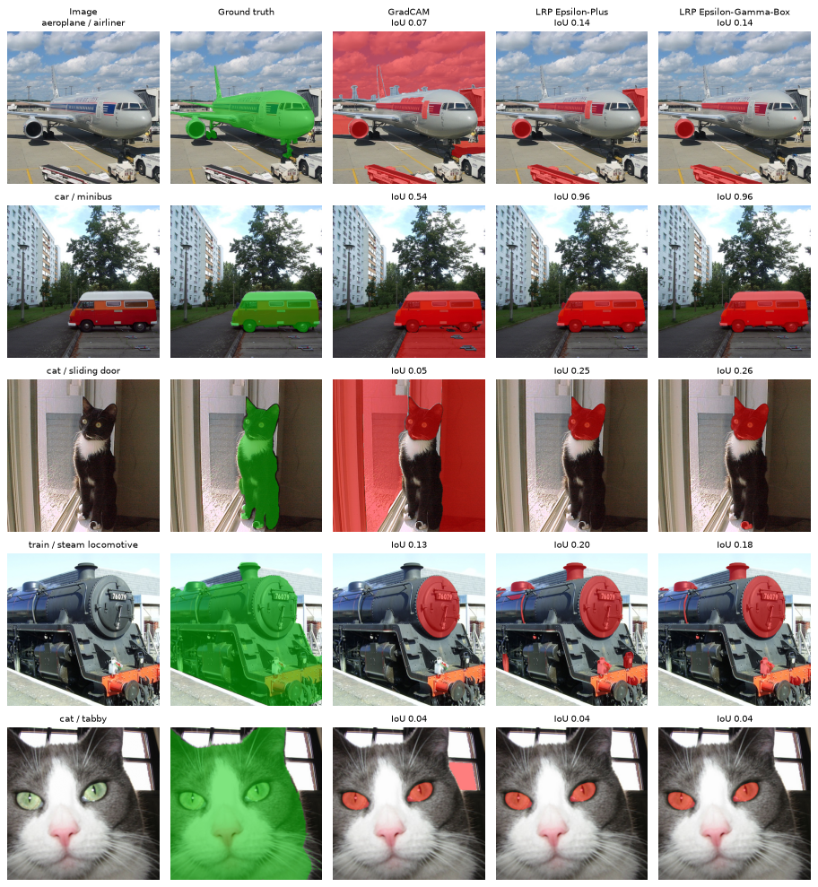

# Automatic Image Segmentation with SAM and Saliency Maps

Segment the object an image classifier "sees", without any prompt or label:
SAM's automatic mask generator segments **everything** in the image, and a
saliency map of the classifier decides **which segments belong to the object**.

ResNet50 classifies the photo of two landing Falcon Heavy boosters as
*missile*; LayerCAM highlights the boosters; SAM finds 34 masks; the pipeline
selects the clusters that carry the relevance.

## How it works

1. **Classify and explain.** ResNet50 predicts the ImageNet class; an XAI method
   (LayerCAM, GradCAM or LRP) produces a saliency map for that class, scaled to
   the image and to [0, 1].
2. **Segment everything.** `SamAutomaticMaskGenerator` samples a 32×32 point
   grid (plus crops) and returns every mask it finds.
3. **Rank the masks.** Each mask is scored by a *weighted IoU*: its soft IoU with
   the saliency map times the mean relevance inside the mask. Large masks with
   little relevance (sky, ground) rank low.

   

4. **Cluster.** Going down the ranking, each mask absorbs the later masks it
   overlaps by more than 20 %, so the parts of one object (booster, landing
   legs, plume) end up in one cluster.

   

5. **Select.** Clusters covering more than half of the image (`max_area`) are
   background and left out; with a weak heatmap around the object their size
   alone can earn them a high score (the sky above). The remaining clusters are
   kept up to the elbow of their score curve; their union is the segmentation.

   

## Evaluation

`notebooks/evaluation.ipynb` runs the pipeline on Pascal VOC 2012 images with a
single object class and compares the selection with the ground truth. On a
sample of 5 images (seed 123, SAM ViT-B), mean over the images:

| Saliency method | IoU | Dice | Precision | Recall |
| --- | --- | --- | --- | --- |
| LRP Epsilon-Plus | 0.318 | 0.408 | 0.858 | 0.333 |
| LRP Epsilon-Gamma-Box | 0.316 | 0.405 | 0.876 | 0.328 |
| LRP Epsilon-Plus, layer2.0.conv2 | 0.315 | 0.402 | 0.863 | 0.331 |
| GradCAM | 0.166 | 0.246 | 0.450 | 0.330 |

The same 5 images (title: Pascal label / ResNet50 prediction; photos from
Pascal VOC 2012, originally from Flickr):

LRP finds the right segments (high precision) but stops too early: the head of
a cat, the front of a locomotive, the eyes of a tabby (low recall). GradCAM's
coarse map also pulls in background such as the sky or a door. The notebook
writes the full results to `results/` (not tracked).

---

A group project of the Data Science project course at TU Berlin (DAI-Labor),
led by [karray](https://github.com/karray).
