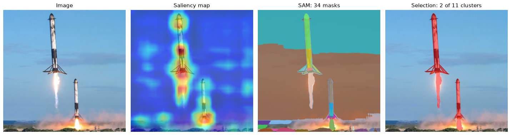
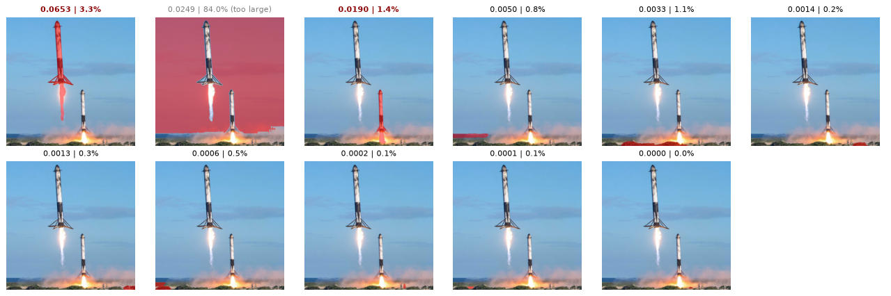
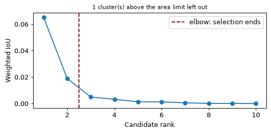

# Automatic Image Segmentation with SAM and Saliency Maps

Segment the object an image classifier "sees", without any prompt or label:
SAM's automatic mask generator segments **everything** in the image, and a
saliency map of the classifier decides **which segments belong to the object**.



ResNet50 classifies the photo of two landing Falcon Heavy boosters as
*missile*; LayerCAM highlights the boosters; SAM finds 34 masks; the pipeline
selects the clusters that carry the relevance.

## How it works

1. **Classify and explain.** ResNet50 predicts the ImageNet class; an XAI method
   (LayerCAM, GradCAM or LRP) produces a saliency map for that class, scaled to
   the image and to [0, 1].
2. **Segment everything.** `SamAutomaticMaskGenerator` samples a 32×32 point
   grid (plus crops) and returns every mask it finds.
3. **Rank the masks.** Each mask is scored by a *weighted IoU*: its soft IoU with
   the saliency map times the mean relevance inside the mask. Large masks with
   little relevance (sky, ground) rank low.

   

4. **Cluster.** Going down the ranking, each mask absorbs the later masks it
   overlaps by more than 20 %, so the parts of one object (booster, landing
   legs, plume) end up in one cluster.

   

5. **Select.** Clusters covering more than half of the image (`max_area`) are
   background and left out; with a weak heatmap around the object their size
   alone can earn them a high score (the sky above). The remaining clusters are
   kept up to the elbow of their score curve; their union is the segmentation.

   

## Evaluation

`notebooks/evaluation.ipynb` runs the pipeline on Pascal VOC 2012 images with a
single object class and compares the selection with the ground truth. On a
sample of 5 images (seed 123, SAM ViT-B), mean over the images:

| Saliency method | IoU | Dice | Precision | Recall |
| --- | --- | --- | --- | --- |
| LRP Epsilon-Plus | 0.318 | 0.408 | 0.858 | 0.333 |
| LRP Epsilon-Gamma-Box | 0.316 | 0.405 | 0.876 | 0.328 |
| LRP Epsilon-Plus, layer2.0.conv2 | 0.315 | 0.402 | 0.863 | 0.331 |
| GradCAM | 0.166 | 0.246 | 0.450 | 0.330 |

LRP finds the right segments (high precision) but often only part of the
object (low recall). The notebook writes the full results to `results/` (not
tracked).

## Repository

| Path | Content |
| --- | --- |
| `src/saliency_sam/segmentation.py` | the pipeline: mask ranking, clustering, elbow selection (`segment`) |
| `src/saliency_sam/xai.py` | saliency methods: `LayerCAM`, `GradCAM`, `LRP` (zennit) |
| `src/saliency_sam/models.py` | loading SAM, ResNet50 and images |
| `src/saliency_sam/evaluation.py` | Pascal VOC 2012 loading and the `Evaluator` |
| `src/saliency_sam/metrics.py` | IoU, Dice, precision/recall, boundary IoU, surface distances |
| `src/saliency_sam/plotting.py` | the figures above |
| `notebooks/demo.ipynb` | the Falcon example, step by step |
| `notebooks/evaluation.ipynb` | GradCAM and LRP variants on Pascal VOC, compared with the ground truth |
| `examples/` | input images |
| `scripts/download_checkpoints.sh` | SAM and ResNet50 weights into `checkpoints/` |
| `scripts/make_figures.py` | regenerates the figures in `docs/images/` |
| `docs/reports/` | slides of the TU Berlin data science project (milestones, final presentation) |
| `tools/thread-limits/` | caps BLAS/OpenMP threads at Python startup (see below) |

## Usage

```python
from saliency_sam import load_image, load_resnet, load_sam, mask_generator, predict, segment, to_tensor
from saliency_sam.xai import LayerCAM, to_image_size

image = load_image("examples/falcon-heavy-boosters.jpeg")
sam, resnet = load_sam("vit_b"), load_resnet()

x = to_tensor(image).unsqueeze(0).to("cuda")
class_idx = predict(resnet, x)
heatmap = to_image_size(LayerCAM(resnet, resnet.layer4)(x, class_idx), image.shape)

result = segment(image, heatmap, mask_generator(sam))
result.mask        # bool (H, W): the segmentation
result.clusters    # all clusters with score and area, best first
```

## Setup

The project uses [uv](https://docs.astral.sh/uv/). Python 3.14 and all
dependencies, including PyTorch 2.15 with CUDA 13 (NVIDIA driver >= 580), are
pinned in `pyproject.toml` and `uv.lock`; `uv sync` also installs
`saliency_sam` itself (editable).

```bash
uv sync                               # .venv with all dependencies
./scripts/download_checkpoints.sh     # SAM ViT-B + ResNet50 -> checkpoints/ (--vit-h: also ViT-H)
uv run jupyter lab                    # open notebooks/demo.ipynb
```

To use the environment from an existing Jupyter, register it as a kernel once:

```bash
uv run python -m ipykernel install --user --name automatic-image-segmentation \
    --display-name "Python (automatic-image-segmentation)"
```

The evaluation notebook needs Pascal VOC 2012 in `datasets/VOCSegmentation`;
it downloads it (about 2 GB) with `DOWNLOAD = True`.

**Thread limits:** `tools/thread-limits` (installed by `uv sync`) caps
`OPENBLAS_NUM_THREADS`, `OMP_NUM_THREADS` etc. at 32 when the venv's Python
starts; without it NumPy's OpenBLAS crashes on machines with more than about
128 cores. Variables you set yourself take precedence.

### Docker

```bash
cp .env.example .env    # set JUPYTER_TOKEN
docker compose up --build
```

Jupyter Lab on port 8888 with GPU access; the checkpoints are baked into the
image (`/usr/models`, found through `CHECKPOINT_DIR`).
